# 📚 DSA Practice Session

A comprehensive **Data Structures & Algorithms** practice repository built with **C# (.NET 7.0)**. Contains 120+ solutions organized by topic — from classic interview problems to competitive programming contests.

## 🗺️ Repository Map

```mermaid
flowchart TD

subgraph group_structures["Data Structures"]
  node_arrays["Arrays"]
  node_linked_list["Linked Lists"]
  node_queues["Queues"]
  node_stacks["Stacks"]
end

subgraph group_algorithms["Core Algorithms"]
  node_dynamic_programming["Dynamic Programming"]
  node_searching["Searching"]
  node_sets["Sets"]
  node_sorting["Sorting"]
end

subgraph group_trees_strings["Trees & Strings"]
  node_binary_trees["Binary Trees"]
  node_strings["Strings"]
  node_tries["Tries"]
end

subgraph group_contests["Mixed & Contest"]
  node_problem_solving["Problem Solving"]
  node_contest_3["Contest 3"]
  node_contest_4["Contest 4"]
  node_contest_5["Contest 5"]
end

node_learner(("Learner"))

node_learner -->|"browses"| node_arrays
node_learner -->|"browses"| node_linked_list
node_learner -->|"browses"| node_queues
node_learner -->|"browses"| node_stacks
node_learner -->|"browses"| node_dynamic_programming
node_learner -->|"browses"| node_searching
node_learner -->|"browses"| node_sets
node_learner -->|"browses"| node_sorting
node_learner -->|"browses"| node_binary_trees
node_learner -->|"browses"| node_strings
node_learner -->|"browses"| node_tries
node_learner -->|"browses"| node_problem_solving
node_learner -->|"browses"| node_contest_3
node_learner -->|"browses"| node_contest_4
node_learner -->|"browses"| node_contest_5

classDef toneBlue fill:#dbeafe,stroke:#2563eb,stroke-width:1.5px,color:#172554
classDef toneAmber fill:#fef3c7,stroke:#d97706,stroke-width:1.5px,color:#78350f
classDef toneMint fill:#dcfce7,stroke:#16a34a,stroke-width:1.5px,color:#14532d
classDef toneRose fill:#ffe4e6,stroke:#e11d48,stroke-width:1.5px,color:#881337
classDef toneIndigo fill:#e0e7ff,stroke:#4f46e5,stroke-width:1.5px,color:#312e81

class node_arrays,node_linked_list,node_queues,node_stacks toneBlue
class node_dynamic_programming,node_searching,node_sets,node_sorting toneAmber
class node_binary_trees,node_strings,node_tries toneMint
class node_problem_solving,node_contest_3,node_contest_4,node_contest_5 toneRose
class node_learner toneIndigo
```



> *Diagram generated by [gitdiagram.com](https://gitdiagram.com/kenkage/practice-session)*

---

## 🚀 How to Run

Every problem has a `public static void Run()` method. A central **menu-driven runner** lets you execute any problem:

```bash
# Interactive menu — browse all problems by category
dotnet run

# Run a specific problem directly by class name
dotnet run -- MergeSortProgram
dotnet run -- PascalTriangle
dotnet run -- KingsLand
```

In the interactive menu you can also **search by name** — just type part of a problem name instead of a number.

---

## 📂 Problem Index

### 🔵 Arrays (6 problems)
| # | Problem | File | Technique |
|---|---------|------|-----------|
| 1 | Count Anagram | [`CountAnagram.cs`](test/Arrays/CountAnagram.cs) | Sliding Window, HashMap |
| 2 | Diwali Lights | [`DiwaliLights.cs`](test/Arrays/DiwaliLights.cs) | Math |
| 3 | First Negative Element | [`FirstNegativeElement.cs`](test/Arrays/FirstNegativeElement.cs) | Sliding Window |
| 4 | Rohan Loves 0 (v1) | [`RohanLoves0(1).cs`](test/Arrays/RohanLoves0(1).cs) | Arrays |
| 5 | Rohan Loves 0 Extended | [`RohanLoves0(1)Extended.cs`](test/Arrays/RohanLoves0(1)Extended.cs) | Arrays |
| 6 | Rohan Loves 0 (v2) | [`RohanLoves0(2).cs`](test/Arrays/RohanLoves0(2).cs) | Arrays |

### 🌳 Binary Trees (16 problems)
| # | Problem | File | Technique |
|---|---------|------|-----------|
| 1 | Aggressive Cows | [`AggressiveCows.cs`](test/Binary%20Trees/AggressiveCows.cs) | Binary Search on Answer |
| 2 | Book Allocation Problem | [`BookAllocationProblem.cs`](test/Binary%20Trees/BookAllocationProblem.cs) | Binary Search on Answer |
| 3 | Concatenate Nodes | [`ConcatenateNodes.cs`](test/Binary%20Trees/ConcatenateNodes.cs) | BFS, Level Order |
| 4 | Index of Target | [`IndexOfTarget.cs`](test/Binary%20Trees/IndexOfTarget.cs) | BFS |
| 5 | Level Order Traversal | [`LevelOrderTraversing.cs`](test/Binary%20Trees/LevelOrderTraversing.cs) | BFS, Queue |
| 6 | Max Element in Array | [`MaxElementInArray.cs`](test/Binary%20Trees/MaxElementInArray.cs) | Tree Traversal |
| 7 | Max Sum Top View | [`MaxSum_TopView_BinaryTree.cs`](test/Binary%20Trees/MaxSum_TopView_BinaryTree.cs) | BFS, Kadane's Algorithm |
| 8 | Minimum Risk Path in BST | [`MinimumriskPathInBST.cs`](test/Binary%20Trees/MinimumriskPathInBST.cs) | BST Traversal |
| 9 | Optimal Tree Escape | [`OptimalTreeEscape.cs`](test/Binary%20Trees/OptimalTreeEscape.cs) | BFS, Tree |
| 10 | Peak Element | [`PeakElement.cs`](test/Binary%20Trees/PeakElement.cs) | Binary Search |
| 11 | Sort the BST | [`SortTheBST.cs`](test/Binary%20Trees/SortTheBST.cs) | Inorder Traversal |
| 12 | Sweepers Problem | [`SweepersProblem.cs`](test/Binary%20Trees/SweepersProblem.cs) | Binary Search on Answer |
| 13 | Three Numbers Product | [`ThreeNumbersProduct.cs`](test/Binary%20Trees/ThreeNumbersProduct.cs) | Tree, Math |
| 14 | Watchmen of Binary Tree | [`WatchmenOfBinaryTree.cs`](test/Binary%20Trees/WatchmenOfBinaryTree.cs) | DFS, Tree DP |
| 15 | ZigZag Traversal | [`ZigZagTraversal.cs`](test/Binary%20Trees/ZigZagTraversal.cs) | BFS, Deque |
| 16 | ZigZag Traversal (v2) | [`ZigZagTravesal.cs`](test/Binary%20Trees/ZigZagTravesal.cs) | BFS |

### 🟡 Dynamic Programming (28 problems)
| # | Problem | File | Technique |
|---|---------|------|-----------|
| 1 | 0-1 Knapsack | [`0-1Knapsack.cs`](test/Dynamic%20Programming/0-1Knapsack.cs) | Tabulation |
| 2 | Break the Number | [`BreakTheNumber.cs`](test/Dynamic%20Programming/BreakTheNumber.cs) | DP |
| 3 | Bunty Horror House | [`BuntyHorrorHouse.cs`](test/Dynamic%20Programming/BuntyHorrorHouse.cs) | DP on Grid |
| 4 | Cookies Distribution | [`CookiesDistribution.cs`](test/Dynamic%20Programming/CookiesDistribution.cs) | DP |
| 5 | Crossing Jungle | [`CrossingJungle.cs`](test/Dynamic%20Programming/CrossingJungle.cs) | DP |
| 6 | Egg Drop | [`EggDrop.cs`](test/Dynamic%20Programming/EggDrop.cs) | Memoization |
| 7 | FAANG Companies | [`FAANG_Companies.cs`](test/Dynamic%20Programming/FAANG_Companies.cs) | DP |
| 8 | Longest Common Substring | [`LongestCommomSubstring.cs`](test/Dynamic%20Programming/LongestCommomSubstring.cs) | Tabulation |
| 9 | Longest Palindromic Subsequence | [`LongestPalindromicSubsequence.cs`](test/Dynamic%20Programming/LongestPalindromicSubsequence.cs) | DP, LCS Variant |
| 10 | Max Falling Path Sum II | [`MaxFallingPathSum2.cs`](test/Dynamic%20Programming/MaxFallingPathSum2.cs) | DP on Grid |
| 11 | Min Coins (v1) | [`MinCoins1.cs`](test/Dynamic%20Programming/MinCoins1.cs) | Tabulation |
| 12 | Min Coins Required | [`MinCoinsRequired1.cs`](test/Dynamic%20Programming/MinCoinsRequired1.cs) | Tabulation |
| 13 | Min Jump (Memoization) | [`MinJumpMemo.cs`](test/Dynamic%20Programming/MinJumpMemo.cs) | Memoization |
| 14 | Min Jumps | [`MinJumps.cs`](test/Dynamic%20Programming/MinJumps.cs) | DP, Greedy |
| 15 | Min Tax Paid I | [`MinTaxPaid_I.cs`](test/Dynamic%20Programming/MinTaxPaid_I.cs) | DP |
| 16 | Min Tax Paid II | [`MinTaxPaid_II.cs`](test/Dynamic%20Programming/MinTaxPaid_II.cs) | DP |
| 17 | Partition with Given Difference | [`PartitionWithGivenDifference.cs`](test/Dynamic%20Programming/PartitionWithGivenDifference.cs) | Subset Sum Variant |
| 18 | Partition with Min Sum Diff | [`PartitionWithMiniSumDiff.cs`](test/Dynamic%20Programming/PartitionWithMiniSumDiff.cs) | Subset Sum |
| 19 | Rob House | [`RobHouse.cs`](test/Dynamic%20Programming/RobHouse.cs) | DP |
| 20 | Rob House II | [`RobHouse2.cs`](test/Dynamic%20Programming/RobHouse2.cs) | Circular DP |
| 21 | Secret Code | [`SecretCode.cs`](test/Dynamic%20Programming/SecretCode.cs) | DP |
| 22 | Sentence Count | [`SectenceCount.cs`](test/Dynamic%20Programming/SectenceCount.cs) | DP, String |
| 23 | Simplified Fractions | [`SimplifiedFractions.cs`](test/Dynamic%20Programming/SimplifiedFractions.cs) | Math, GCD |
| 24 | Stolen Gifts | [`StolenGifts.cs`](test/Dynamic%20Programming/StolenGifts.cs) | Knapsack Variant |
| 25 | Subset Sum to K | [`SubSetSumTo_K.cs`](test/Dynamic%20Programming/SubSetSumTo_K.cs) | Tabulation |
| 26 | The New Classmate | [`TheNewClassmate.cs`](test/Dynamic%20Programming/TheNewClassmate.cs) | DP |
| 27 | Unique Paths I | [`UniquePath1.cs`](test/Dynamic%20Programming/UniquePath1.cs) | Grid DP |
| 28 | Unique Paths II | [`UniquePath2.cs`](test/Dynamic%20Programming/UniquePath2.cs) | Grid DP with Obstacles |

### 🔗 Linked Lists (8 problems)
| # | Problem | File | Technique |
|---|---------|------|-----------|
| 1 | Insert at Start (DLL) | [`InsertAtStart.cs`](test/LinkedList/InsertAtStart.cs) | Doubly Linked List |
| 2 | LRU Cache | [`LRUCache.cs`](test/LinkedList/LRUCache.cs) | DLL + HashMap |
| 3 | Merge Sorted Lists | [`MergeSortedList.cs`](test/LinkedList/MergeSortedList.cs) | Two Pointer |
| 4 | Middle of Linked List | [`MiddleOfLinkedList.cs`](test/LinkedList/MiddleOfLinkedList.cs) | Slow/Fast Pointer |
| 5 | Palindromic Linked List | [`PalindromicLinkedList.cs`](test/LinkedList/PalindromicLinkedList.cs) | Reverse Half |
| 6 | Reverse Linked List | [`ReverseLinkLst.cs`](test/LinkedList/ReverseLinkLst.cs) | Iterative Reverse |
| 7 | Rotate Nodes | [`RotateNodes.cs`](test/LinkedList/RotateNodes.cs) | DLL Rotation |
| 8 | Sum of Linked Lists | [`SumOfLinkedList.cs`](test/LinkedList/SumOfLinkedList.cs) | Carry Addition |

### 📦 Queues (5 problems)
| # | Problem | File | Technique |
|---|---------|------|-----------|
| 1 | First Non-Repeating | [`FirstNonRepeating.cs`](test/Queue/FirstNonRepeating.cs) | Queue + HashMap |
| 2 | Implement Queue | [`ImplementQueue.cs`](test/Queue/ImplementQueue.cs) | Queue Basics |
| 3 | Petrol Pump | [`PetrolPump.cs`](test/Queue/PetrolPump.cs) | Circular Queue, Greedy |
| 4 | Queue Functions | [`QueueFunc.cs`](test/Queue/QueueFunc.cs) | Queue Operations |
| 5 | Reverse Queue | [`ReverseQueue.cs`](test/Queue/ReverseQueue.cs) | Stack + Queue |

### 📚 Stacks (10 problems)
| # | Problem | File | Technique |
|---|---------|------|-----------|
| 1 | 132 Pattern | [`132Pattern.cs`](test/Stack/132Pattern.cs) | Monotonic Stack |
| 2 | Calculate Difference | [`CalculateDifference.cs`](test/Stack/CalculateDifference.cs) | Stack |
| 3 | Collisions | [`Collisions.cs`](test/Stack/Collisions.cs) | Stack Simulation |
| 4 | Count the Operation | [`CountTheOperation.cs`](test/Stack/CountTheOperation.cs) | Expression Parsing |
| 5 | Count the Operation (Stack) | [`CountTheOperation_Stack.cs`](test/Stack/CountTheOperation_Stack.cs) | Stack |
| 6 | King's Land | [`KingsLand.cs`](test/Stack/KingsLand.cs) | Monotonic Stack, Prefix Sum |
| 7 | Largest Rectangle Area | [`LargestRectangleArea.cs`](test/Stack/LargestRectangleArea.cs) | Monotonic Stack |
| 8 | Max Partitions | [`MaxPartitions.cs`](test/Stack/MaxPartitions.cs) | Greedy |
| 9 | Max Width Ramp | [`MaxWidthRamp.cs`](test/Stack/MaxWidthRamp.cs) | Monotonic Stack |
| 10 | Tunnel | [`Tunnel.cs`](test/Stack/Tunnel.cs) | Stack Simulation |

### 🔍 Searching (5 problems)
| # | Problem | File | Technique |
|---|---------|------|-----------|
| 1 | Maximum Sweetness | [`MaximumSweetness.cs`](test/Searching/MaximumSweetness.cs) | Binary Search on Answer |
| 2 | Median of 2 Sorted Arrays | [`MedianOf2SortedArray.cs`](test/Searching/MedianOf2SortedArray.cs) | Binary Search — O(log min(m,n)) |
| 3 | Search in Rotated Sorted Array | [`SearchInRotatedSortedArray.cs`](test/Searching/SearchInRotatedSortedArray.cs) | Modified Binary Search |
| 4 | Smallest Divisor | [`SmallestDivisorSolution.cs`](test/Searching/SmallestDivisorSolution.cs) | Binary Search on Answer |
| 5 | Square Root | [`SquareRoot.cs`](test/Searching/SquareRoot.cs) | Binary Search |

### 🔶 Sorting (9 problems)
| # | Problem | File | Technique |
|---|---------|------|-----------|
| 1 | Combine Books | [`CombineBooks.cs`](test/Sorting/CombineBooks.cs) | Sorting |
| 2 | Combine Books (v2) | [`CombineBooks2.cs`](test/Sorting/CombineBooks2.cs) | Sorting |
| 3 | Count Bubble Sort Swaps | [`CountBubbleSortSwaps.cs`](test/Sorting/CountBubbleSortSwaps.cs) | Merge Sort, Inversion Count |
| 4 | Maximum Stones | [`MaximumStones.cs`](test/Sorting/MaximumStones.cs) | Greedy, Sorting |
| 5 | Merge Sort | [`MergeSortProgram.cs`](test/Sorting/MergeSortProgram.cs) | Divide & Conquer |
| 6 | Restaurant Tip | [`RestaurantTip.cs`](test/Sorting/RestaurantTip.cs) | Sorting |
| 7 | Sort Color Balls | [`SortColorBall.cs`](test/Sorting/SortColorBall.cs) | Dutch National Flag |
| 8 | Special Pairs | [`SpecialPairs.cs`](test/Sorting/SpecialPairs.cs) | Merge Sort, Inversion |
| 9 | Wave Array | [`waveArray.cs`](test/Sorting/waveArray.cs) | Greedy Swap |

### 🧩 Sets (5 problems)
| # | Problem | File | Technique |
|---|---------|------|-----------|
| 1 | Berlogging | [`Berlogging.cs`](test/Sets/Berlogging.cs) | HashSet |
| 2 | Longest Subarray | [`LongestSubarray.cs`](test/Sets/LongestSubarray.cs) | Sliding Window, Set |
| 3 | Next Least Greater Element | [`NextLeastGreaterElement.cs`](test/Sets/NextLeastGreaterElement.cs) | Stack / Set |
| 4 | Unique Combination (Swap) | [`UniqueCombination_Swap.cs`](test/Sets/UniqueCombination_Swap.cs) | Backtracking |
| 5 | Unique Permutation | [`UniquePermutation.cs`](test/Sets/UniquePermutation.cs) | Backtracking |

### 🌿 Tries (5 problems)
| # | Problem | File | Technique |
|---|---------|------|-----------|
| 1 | AutoComplete | [`AutoComplete.cs`](test/Tries/AutoComplete.cs) | Trie, DFS |
| 2 | Implement Trie | [`ImplementTrie.cs`](test/Tries/ImplementTrie.cs) | Trie Insert |
| 3 | Maximum XOR Pair | [`MaximumXOR_Pair.cs`](test/Tries/MaximumXOR_Pair.cs) | Binary Trie, Bit Manipulation |
| 4 | Remove Word | [`RemoveWord.cs`](test/Tries/RemoveWord.cs) | Trie Delete (Recursive) |
| 5 | Search Trie | [`SearchTrie.cs`](test/Tries/SearchTrie.cs) | Trie Search |

### 🧵 Strings (2 problems)
| # | Problem | File | Technique |
|---|---------|------|-----------|
| 1 | Mars Mission | [`MarsMission.cs`](test/Strings/MarsMission.cs) | String Parsing |
| 2 | Mars Mission (v2) | [`MarsMission_Again.cs`](test/Strings/MarsMission_Again.cs) | String Parsing |

### 🧪 Problem Solving (5 problems)
| # | Problem | File | Technique |
|---|---------|------|-----------|
| 1 | Alternating Split of CLL | [`AlternatingSplitofCircularLinkedList.cs`](test/ProblemSolving/AlternatingSplitofCircularLinkedList.cs) | Circular Linked List |
| 2 | Frequency Sorting | [`FrequencySorting.cs`](test/ProblemSolving/FrequencySorting.cs) | HashMap, Custom Sort |
| 3 | Maximum Gap | [`MaximumGap.cs`](test/ProblemSolving/MaximumGap.cs) | Bucket Sort / Sorting |
| 4 | Minimum Cost Array | [`MinimumCostArray.cs`](test/ProblemSolving/MinimumCostArray.cs) | Greedy |
| 5 | Sort Colors | [`SortColorsSolution.cs`](test/ProblemSolving/SortColorsSolution.cs) | Dutch National Flag |

### 🏆 TGP Contest 3 (3 problems)
| # | Problem | File | Technique |
|---|---------|------|-----------|
| 1 | Basic Calculator | [`BasicCalculator.cs`](test/TGP-C3/BasicCalculator.cs) | Stack, Expression Parsing |
| 2 | Group Anagrams | [`GroupAnagrams.cs`](test/TGP-C3/GroupAnagrams.cs) | HashMap, Sorting |
| 3 | Sort Array on Frequency | [`SortArrayOnFrequency.cs`](test/TGP-C3/SortArrayOnFrequency.cs) | HashMap, Custom Sort |

### 🏆 TGP Contest 4 (6 problems)
| # | Problem | File | Technique |
|---|---------|------|-----------|
| 1 | Coach Manish | [`CoachManish.cs`](test/TGP-C4/CoachManish.cs) | Greedy / DP |
| 2 | New Matrix | [`NewMatrix.cs`](test/TGP-C4/NewMatrix.cs) | Matrix, BFS |
| 3 | Number Game | [`NumberGame.cs`](test/TGP-C4/NumberGame.cs) | Game Theory |
| 4 | Remove Digits | [`RemoveDigits.cs`](test/TGP-C4/RemoveDigits.cs) | Stack, Greedy |
| 5 | Remove Duplicate Letters | [`RemoveDuplicateLetters.cs`](test/TGP-C4/RemoveDuplicateLetters.cs) | Monotonic Stack |
| 6 | SubArray Sum | [`SubArraySum.cs`](test/TGP-C4/SubArraySum.cs) | Prefix Sum, HashMap |

### 🏆 TGP Contest 5 (3 problems)
| # | Problem | File | Technique |
|---|---------|------|-----------|
| 1 | Critical Connection | [`CriticalConnection.cs`](test/TGP-C5/CriticalConnection.cs) | Tarjan's Algorithm, Graph |
| 2 | Odd-Even Linked List | [`OddEvenLinkList.cs`](test/TGP-C5/OddEvenLinkList.cs) | Linked List Rearrangement |
| 3 | Star Graph | [`StarGraph.cs`](test/TGP-C5/StarGraph.cs) | Graph, Degree Count |

### 📌 General / Root (7 problems)
| # | Problem | File | Technique |
|---|---------|------|-----------|
| 1 | First Unique Character | [`FirstUniqueCharacter.cs`](test/FirstUniqueCharacter.cs) | HashMap |
| 2 | Gemstone | [`Gemstone.cs`](test/Gemstone.cs) | HashSet, String |
| 3 | Good String | [`GoodString.cs`](test/GoodString.cs) | Stack |
| 4 | Interchangeable Rectangles | [`InterchangeableRectangles.cs`](test/InterchangeableRectangles.cs) | HashMap, GCD |
| 5 | Pascal Triangle | [`PascalTriangle.cs`](test/PascalTriangle.cs) | Simulation |
| 6 | Password Cracker | [`PasswordCracker.cs`](test/PasswordCracker.cs) | Recursion, Backtracking |
| 7 | Tunnel | [`Tunnel.cs`](test/Tunnel.cs) | Stack Simulation |

---

## 🛠️ Tech Stack

| | |
|---|---|
| **Language** | C# |
| **Runtime** | .NET 7.0 |
| **Project Type** | Console App |
| **Runner** | Reflection-based menu (`Program.cs`) |

## 📊 Coverage by Topic

```
Dynamic Programming  ████████████████████████████  28
Binary Trees         ████████████████              16
Stack                ██████████                    10
Sorting              █████████                      9
Linked Lists         ████████                       8
General              ███████                        7
Arrays               ██████                         6
TGP-C4               ██████                         6
Searching            █████                          5
Queue                █████                          5
Sets                 █████                          5
Tries                █████                          5
Problem Solving      █████                          5
TGP-C3               ███                            3
TGP-C5               ███                            3
Strings              ██                             2
```

---

## 📝 License

This is a personal practice repository for learning and interview preparation.
